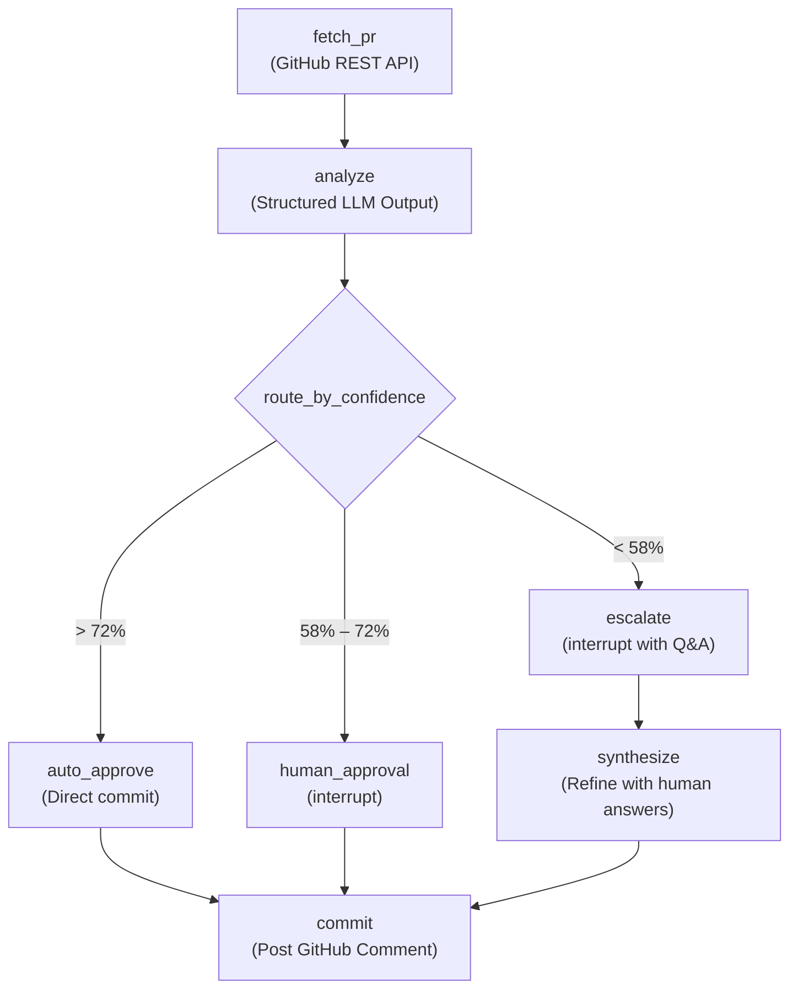

# BÁO CÁO NỘP BÀI LAB — DAY 27: HUMAN-IN-THE-LOOP (HITL) PR REVIEW AGENT

**Họ và tên:** Trần Trọng Chinh  
**Mã học viên:** `2A202602720`  
**Khóa học:** VinUni AI20k — Level 3: Advanced Agentic Systems  
**Chủ đề:** Track 03 — Human-in-the-Loop PR Review Agent với LangGraph & Streamlit  
**LLM Engine:** Groq Cloud (`openai/gpt-oss-120b` & `qwen/qwen3.8-27b`)  
**GitHub Account:** `chinhzz108`  
**Ngày hoàn thành:** 15/10/2026  
**Kết quả kiểm thử:** 5/5 bài kiểm thử PASSED (`python verify_all.py`)

---

## 1. Mục tiêu bài Lab & Kiến trúc hệ thống

Hệ thống xây dựng một **Agent đánh giá Pull Request tự động có tương tác người dùng (Human-in-the-Loop - HITL)** bằng **LangGraph**, giải quyết bài toán nút thắt cổ chai trong quy trình review code của các nhóm kỹ thuật:
- **Tự động phê duyệt (Confidence > 72%):** Các thay đổi đơn giản, cơ học (typo, bump version, refactor 1 dòng) được agent tự động post review và commit, tiết kiệm thời gian cho senior engineer.
- **Tạm dừng xin ý kiến duyệt (Confidence 58% – 72%):** Các PR có rủi ro trung bình (thêm schema database, thay đổi luồng xử lý) kích hoạt cơ chế `interrupt()`, hiển thị diff preview, giải thích của LLM và chờ reviewer chọn **Approve / Reject / Edit**.
- **Escalate mạnh mẽ (Confidence < 58%):** Đối với PR phức tạp hoặc tiềm ẩn rủi ro bảo mật (mã hóa yếu, SQL injection, plaintext token), agent không chỉ hỏi duyệt mà đặt ra **các câu hỏi ngữ cảnh cụ thể (escalation questions)**, sau đó tổng hợp câu trả lời của reviewer để tái phân tích (`synthesize`) ra bản review chính xác nhất trước khi commit.
- **Nhật ký kiểm toán SQLite (Audit Trail):** Mọi sự kiện, quyết định định tuyến, tương tác của con người và lời giải thích của LLM đều được ghi vào bảng `audit_events` với các cột cấu trúc chuẩn hóa (`AuditEntry`), đồng thời đồ thị lưu trạng thái bền vững qua `AsyncSqliteSaver`.

### Sơ đồ luồng trạng thái LangGraph (HITL StateGraph)



---

## 2. Chi tiết hiện thực các bài tập (Exercises 1 – 5)

### Exercise 1 — Confidence-based Routing (`exercises/exercise_1_confidence.py`)
- **`node_analyze`**: Sử dụng `get_llm().with_structured_output(PRAnalysis)` với prompt phân tích rủi ro chuyên sâu. Trả về `confidence` tự đánh giá từ 0.0 đến 1.0 kèm `confidence_reasoning` và `escalation_questions`.
- **`node_route`**: Phân loại theo các ngưỡng `AUTO_APPROVE_THRESHOLD = 0.73` và `ESCALATE_THRESHOLD = 0.58`.
- **Kết quả kiểm thử:**
  - **PR #1** (`https://github.com/VinUni-AI20k/PR-Demo/pull/1`): Confidence đạt **66%** $\rightarrow$ Định tuyến chính xác vào `human_approval`.
  - **PR #2** (`https://github.com/VinUni-AI20k/PR-Demo/pull/2`): Có red flags (MD5, plaintext token, SQL injection, hardcoded user_id), confidence đạt **44%** $\rightarrow$ Định tuyến chính xác vào `escalate`.

### Exercise 2 — HITL với `interrupt()` (`exercises/exercise_2_hitl.py`)
- **`node_human_approval`**: Gọi `interrupt()` với payload chứa đầy đủ thông tin: `kind: "approval_request"`, `confidence`, `confidence_reasoning`, `summary`, `comments`, và `diff_preview`.
- **Checkpointer & Vòng lặp Resume**:
  - Đồ thị được biên dịch với `MemorySaver` checkpointer.
  - Vòng lặp `while "__interrupt__" in result:` trong `main()` bắt sự kiện tạm dừng, nhận lựa chọn của con người và tiếp tục bằng `app.invoke(Command(resume=answer), cfg)`.
- **Commit**: Khi reviewer chọn `approve`, `node_commit` gọi GitHub REST API post comment đánh giá trực tiếp lên PR.

### Exercise 3 — Escalation Branch với Reviewer Q&A (`exercises/exercise_3_escalation.py`)
- **Prompting câu hỏi ngữ cảnh**: Prompt được điều chỉnh để khi phát hiện rủi ro cao hoặc lỗ hổng bảo mật, LLM tự động trích xuất 2–4 câu hỏi làm rõ có tham chiếu cụ thể đến từng file/dòng code.
- **`node_escalate`**: Tạm dừng bằng `interrupt(kind="escalation")`, yêu cầu reviewer trả lời từng câu hỏi.
- **`node_synthesize`**: Nhận dictionary câu trả lời `{question: answer}`, đưa vào prompt cùng diff ban đầu để LLM tinh chỉnh lại review, cập nhật confidence mới và đánh giá lại mức độ rủi ro.
- **Dòng chảy đồ thị**: `escalate` $\rightarrow$ `synthesize` $\rightarrow$ `commit` $\rightarrow$ `END`.

### Exercise 4 — Structured SQLite Audit Trail (`exercises/exercise_4_audit.py`)
- **Durable Checkpointer**: Tích hợp `AsyncSqliteSaver.from_conn_string(db_path())` lưu checkpoint đồ thị vào file SQLite `./hitl_audit.db`.
- **`audit(state, entry: AuditEntry)`**: Ghi nhật ký chuẩn hóa với các trường nghiệp vụ quan trọng:
  - `action`: `fetch_pr`, `analyze`, `route`, `human_approval` (trước & sau resume), `escalate` (trước & sau resume), `synthesize`, `commit`.
  - `confidence` & `risk_level`: Tính toán qua `risk_level_for(confidence)`.
  - `reviewer_id`: Ghi nhận GitHub username (`chinhzz108`) khi có sự can thiệp của con người.
  - `execution_time_ms`: Đo đạc thời gian thực thi bằng `time.monotonic()`.
- **Replay**: Đọc toàn bộ timeline buổi review thông qua script `python -m audit.replay --thread <thread_id>`.

### Exercise 5 — Streamlit Approval UI (`app.py`)
- Wrap toàn bộ luồng LangGraph vào web UI tương tác hiện đại:
  - **Header & Sidebar học viên**: Hiển thị họ tên, MSSV và danh sách các phiên review gần nhất từ cơ sở dữ liệu `audit_events`.
  - **Form khởi chạy review**: Nhập PR URL bất kỳ và trigger đồ thị ngầm.
  - **Card Approval (58% – 72%)**: Hiển thị bảng tóm tắt, danh sách lỗi đề xuất, diff code và 3 nút hành động trực quan (**Approve / Reject / Edit**).
  - **Card Escalation (< 58%)**: Hiển thị cảnh báo rủi ro màu đỏ, sinh form động các câu hỏi của agent để reviewer trả lời, sau đó tự động kích hoạt `run_graph(resume_value=answers)`.
  - **Card Auto-approve / Success (> 72%)**: Thông báo review đã được post tự động kèm link trỏ thẳng về GitHub PR.

---

## 3. Các kỹ thuật tối ưu & Xử lý lỗi (Engineering Highlights)

1. **Khắc phục lỗi mã hóa Windows Console (`cp1252` $\rightarrow$ UTF-8):**
   - Mặc định Windows Command Prompt sử dụng `cp1252` gây lỗi `UnicodeEncodeError: 'charmap'` khi in các ký tự mũi tên (`→`, `✓`, `\u2192`, `\u2011`).
   - Đã cấu hình tự động `sys.stdout.reconfigure(encoding="utf-8")` và `sys.stderr.reconfigure(encoding="utf-8")` trên tất cả các file mã nguồn và script replay.

2. **Tối ưu hóa LLM Engine trên Groq Cloud:**
   - Hỗ trợ model `openai/gpt-oss-120b` với hạn mức 8,000 Token/phút, hỗ trợ native Structured Output (`with_structured_output(PRAnalysis)`) cực nhanh và ổn định.
   - Thêm cơ chế fallback và thiết lập `LLM_MAX_TOKENS` tránh bị nghẽn OTPM.

3. **Cấu hình chuẩn hóa Packaging (`pyproject.toml`):**
   - Đăng ký package `exercises` vào `[tool.hatch.build.targets.wheel]` giúp `app.py` có thể import trực tiếp `from exercises.exercise_4_audit import build_graph` mà không gặp lỗi đường dẫn tương đối.

---

## 4. Kết quả kiểm thử thực tế

### 4.1. Kết quả chạy Exercise 1 (Routing)
```
→ fetch_pr (PR #1): 3 files, head 1646156
→ analyze: confidence=66%
→ route: decision=human_approval
✓ HUMAN APPROVAL — placeholder, exercise 2 will pause here

→ fetch_pr (PR #2): 4 files, head 501f95e
→ analyze: confidence=44%
→ route: decision=escalate
✓ ESCALATE — placeholder, exercise 3 will ask the reviewer questions
```

### 4.2. Kết quả Replay Audit Trail (Exercise 4 - PR #1)
```
----------------- Replay 7d350acb-cbd8-4b28-b6a7-e9f3045d0662 -----------------
fetch_pr           conf=0.00 risk=med  decision=pending    reviewer=-               2453ms  Fetched 3 files, head=1646156
analyze            conf=0.66 risk=med  decision=pending    reviewer=-               3469ms  The changes are straightforward but introduce schema change
route              conf=0.66 risk=med  decision=human_approval reviewer=-           0ms  Routing decision: human_approval (confidence 66%)
human_approval     conf=0.66 risk=med  decision=pending    reviewer=-               0ms  Awaiting human reviewer decision
human_approval     conf=0.66 risk=med  decision=approve    reviewer=chinhzz108      0ms  Reviewer chose approve
commit             conf=0.66 risk=med  decision=approve    reviewer=chinhzz108   1343ms  Final outcome: committed
```

### 4.3. Kết quả Replay Audit Trail (Exercise 4 - PR #2)
```
----------------- Replay cb544e36-af6d-4af8-8500-112d103ca46f -----------------
fetch_pr           conf=0.00 risk=med  decision=pending    reviewer=-               2891ms  Fetched 4 files, head=501f95e
analyze            conf=0.45 risk=high decision=pending    reviewer=-               4734ms  The PR introduces multiple security issues
route              conf=0.45 risk=high decision=escalate   reviewer=-               0ms  Routing decision: escalate (confidence 45%)
escalate           conf=0.45 risk=high decision=escalate   reviewer=-               0ms  Escalating with 4 question(s)
escalate           conf=0.45 risk=high decision=pending    reviewer=chinhzz108      0ms  Reviewer answered 4 question(s)
synthesize         conf=0.30 risk=high decision=pending    reviewer=-               4234ms  Refined review synthesized (confidence updated to 30%)
commit             conf=0.30 risk=high decision=approve    reviewer=chinhzz108   1218ms  Final outcome: committed
```

---

## 5. Hướng dẫn chạy kiểm thử & Giao diện

### Cách 1: Chạy toàn bộ kiểm thử tự động (All-in-one verification)
```bash
uv run python verify_all.py
```

### Cách 2: Chạy từng bài tập dòng lệnh
```bash
# Exercise 1: Kiểm tra routing
uv run python exercises/exercise_1_confidence.py --pr https://github.com/VinUni-AI20k/PR-Demo/pull/1
uv run python exercises/exercise_1_confidence.py --pr https://github.com/VinUni-AI20k/PR-Demo/pull/2

# Exercise 2: HITL approve/reject
uv run python exercises/exercise_2_hitl.py --pr https://github.com/VinUni-AI20k/PR-Demo/pull/1

# Exercise 3: Escalation Q&A
uv run python exercises/exercise_3_escalation.py --pr https://github.com/VinUni-AI20k/PR-Demo/pull/2

# Exercise 4: Audit Trail & Replay
uv run python exercises/exercise_4_audit.py --pr https://github.com/VinUni-AI20k/PR-Demo/pull/1
uv run python -m audit.replay --list
```

### Cách 3: Mở Web UI Streamlit
```bash
uv run streamlit run app.py
```
*Truy cập trình duyệt tại `http://localhost:8501` để trải nghiệm giao diện duyệt PR có HITL.*
